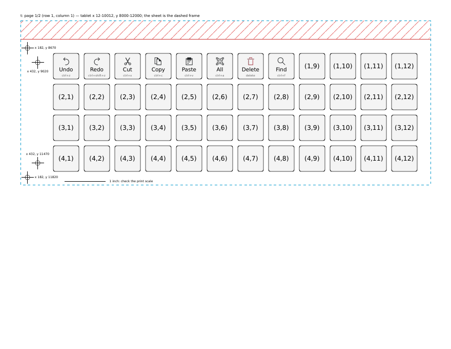

# CalComp DrawingBoard III on Linux

A Linux driver and tools for the **CalComp (GTCO) DrawingBoard III** serial
digitizer, a large-format tablet from the 1990s. It brings one back to life
as a pointing device on a modern desktop through a USB-serial adapter, with
optional **menu buttons** on the parts of the board outside the drawing area.



- **Kernel driver** (`driver/`): a serio input driver. It sets the tablet up,
  decodes its binary format 23, and reports an absolute-position mouse (or,
  optionally, a pen tablet). Pen tip and barrel buttons, and all 16 puck
  buttons, are mapped. It installs through DKMS and starts automatically when
  the adapter is plugged in.
- **Tools** (`tools/`): the attach helper (an `inputattach` for CalComp), a
  live byte monitor, a guided capture recorder, a stream-gap meter, and a
  scanner that finds faulty strips in an old tablet's sensing grid.
- **Menu daemon** (`menud/`): maps a chosen drawing area onto the screen and
  turns the rest of the board into buttons that send key combos or run
  commands. It's configured with a TOML file, prints a 1:1 template (tiled
  Letter pages or one full-size sheet), and has a measure mode for aligning
  the template.
- **Documentation:** the tablet's specifications, protocol and command set
  ([docs/TABLET.md](docs/TABLET.md)), a step-by-step guide
  ([docs/GUIDE.md](docs/GUIDE.md)), and the full development log
  ([NOTES.md](NOTES.md)).

## Status

Tested on a model 34180 (18" × 12", firmware `70171A 07/14/94 16906-4`) with a
cordless pen and a cordless 16-button puck. The adapter was a Prolific PL2303,
on Debian 13 (kernel 7.2) with KDE Plasma 6.3 on Wayland. In daily use: the
pointer, clicks, drag and drawing in GIMP, survival across reboot and
replugging, and the menu buttons. Other DrawingBoard III sizes should work: the
driver asks the tablet for its size. The 4-button puck and the corded tools
weren't available to test.

Not supported: the tablet's own menu-strip macro keys, ASCII and other output
formats, and pressure or tilt pens.

## Quick start

```bash
sudo apt install build-essential linux-headers-$(uname -r) dkms evtest
```

```bash
make -C driver test
```

```bash
sudo packaging/install.sh
```

Plug in the tablet's USB-serial adapter. The pointer follows the pen or puck.
Then follow [docs/GUIDE.md](docs/GUIDE.md) to check for faulty strips, choose
a drawing area, and (optionally) set up menu buttons with `menud`.

## Layout

| Path | |
|---|---|
| [`driver/`](driver/README.md) | kernel driver, decoder tests, DKMS config, module parameters |
| `packaging/` | install/uninstall scripts, systemd service, udev rule |
| `tools/` | attach helper, monitor, capture, gap meter, strip scanner (Python, standard library only) |
| [`menud/`](menud/README.md) | menu-button daemon, example layouts, template printing |
| [`docs/TABLET.md`](docs/TABLET.md) | specifications, setups, configuration keys, format 23, host commands, quirks |
| [`docs/GUIDE.md`](docs/GUIDE.md) | from unboxing to menu buttons, step by step |
| [`captures/`](captures/README.md) | real-tablet captures used by the tests |
| [`NOTES.md`](NOTES.md) | development log |

## License

GPL-2.0 (see [LICENSE](LICENSE)). The kernel driver has to be GPL-2.0, and
everything else uses the same license for simplicity.

## Credits

- The old X.Org `xf86-input-calcomp` driver (Martin Kroeker) was the starting
  point for the protocol. No code from it is included.
- GTCO CalComp's *DrawingBoard III* user guide and *DrawingBoard III Commands*
  reference are summarised in `docs/TABLET.md`. The PDFs aren't included.
- Written with the help of Claude (Anthropic).
